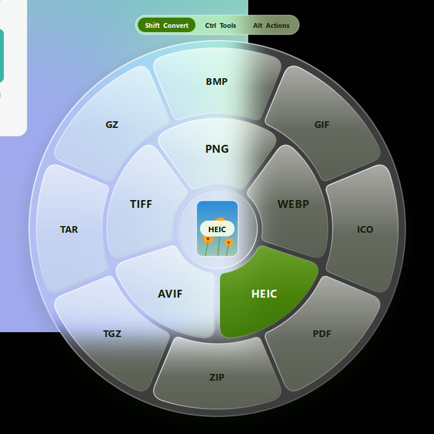
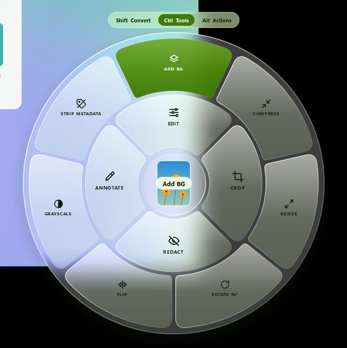
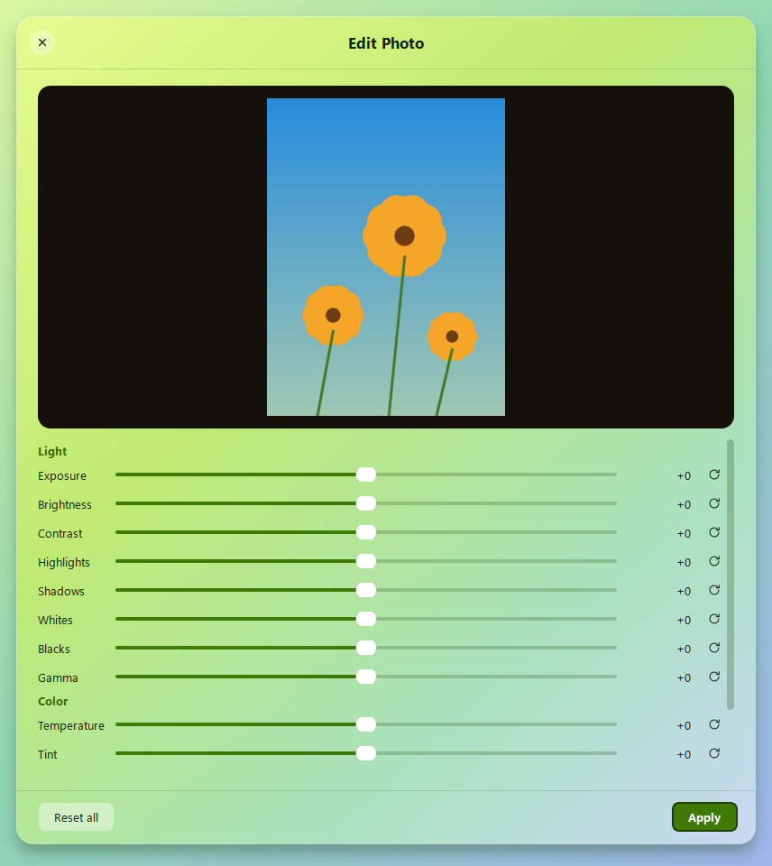
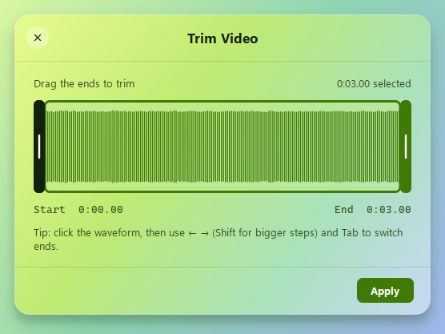
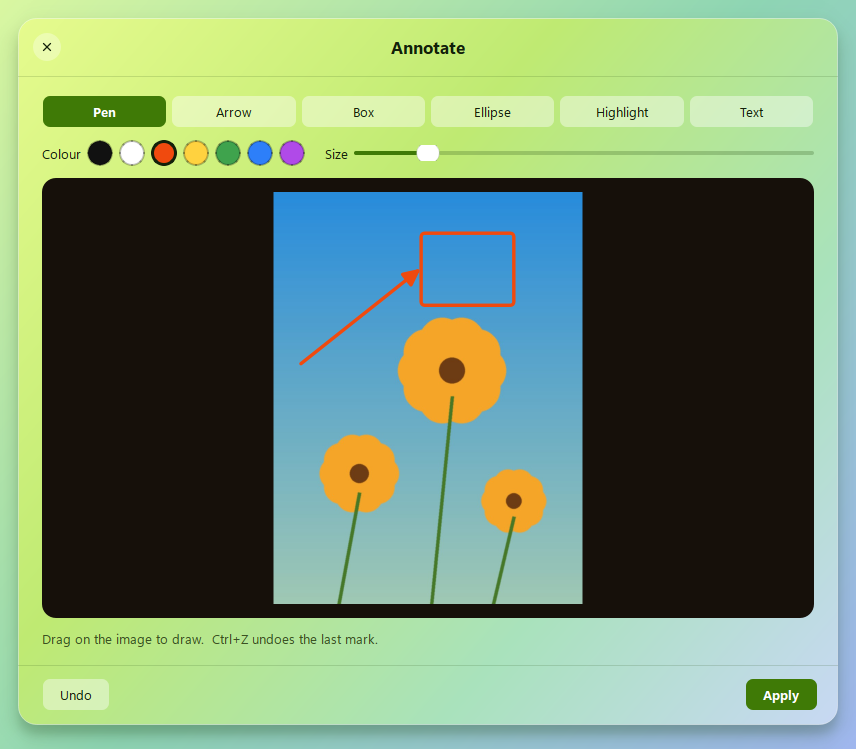
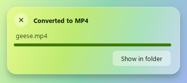

<p align="center"></p>

<h1 align="center">Limewheel</h1>

<p align="center"><b>Drag a file, tap a key, drop it on the wheel.</b><br>
Convert, edit and move files on Windows without opening an app. Everything runs on your PC.</p>

<p align="center">&nbsp;&nbsp;</p>

## Install

Open **PowerShell** (press <kbd>Win</kbd>, type `powershell`, press Enter) and paste:

```powershell
irm https://raw.githubusercontent.com/1949-2005/limewheel/main/install.ps1 | iex
```

The installer downloads Limewheel from this repo's [Releases](https://github.com/1949-2005/limewheel/releases),
checks its SHA-256 fingerprint, installs it for your user account (no admin rights) and opens it.
Run the same command again to update.

Prefer clicking? Download **LimewheelSetup.exe** from the [latest release](https://github.com/1949-2005/limewheel/releases/latest)
and double-click it. Windows may say *"Windows protected your PC"* because the file isn't code-signed:
click **More info → Run anyway**.

**Requirements:** Windows 10 or 11, 64-bit.

## Use

| While dragging a file, tap | Wheel | What's in it |
|---|---|---|
| <kbd>Shift</kbd> | **Convert** | JPG, PNG, WebP, HEIC, AVIF, TIFF, BMP, GIF, ICO, PDF, SVG input · MP4, MOV, MKV, WebM, AVI, WMV, GIF · MP3, M4A, WAV, FLAC, OGG, Opus, AIFF, WMA · PDF → DOCX, PPTX, XLSX, EPUB, JPG/PNG (300 DPI), TXT, MD · DOCX, Markdown, TXT, HTML, RTF, EPUB · XLSX, XLS, ODS, CSV, TSV · SRT ↔ VTT · ZIP, TAR, TAR.GZ, GZIP; opens RAR/7Z |
| <kbd>Ctrl</kbd> | **Tools** | **Edit photo** (exposure, contrast, highlights, temperature…), **Crop** (images and video), **Redact**, **Annotate**, **Add background**, Compress, Resize, Rotate, Flip, Grayscale, Remove metadata · **Trim**, **Split**, **Merge**, **Speed**, **Audio channels**, **Bleep**, Mute, Snapshot, Normalize · PDF merge/split/compress/rotate/extract images |
| <kbd>Alt</kbd> | **Actions** | **Share** (Nearby Share, Mail, Phone Link…), Float, Copy to, Move to, Copy Path, Terminal, Show in Explorer |

- The wheel stays open after you let go of the key. Tap another key to switch wheels, drop on the centre to cancel.
- Touch screen or pen: press, hold briefly, then drag to open the Convert wheel.
- No drag needed: select files in Explorer and press <kbd>Ctrl</kbd>+<kbd>Alt</kbd>+<kbd>T</kbd>, then use the arrow keys and Enter.
- New files are saved next to the original. Originals are never changed.
- Change keys, the hotkey and start-at-sign-in from the tray icon → **Settings…**

<p align="center">&nbsp;&nbsp;</p>
<p align="center">&nbsp;&nbsp;</p>

## Uninstall

**Settings → Apps → Installed apps → Limewheel → Uninstall**, or in PowerShell:

```powershell
irm https://raw.githubusercontent.com/1949-2005/limewheel/main/uninstall.ps1 | iex
```

## Build from source

Needs Python 3.12+ on Windows.

```powershell
pip install -r requirements.txt
python main.py                          # run from source
powershell -ExecutionPolicy Bypass -File build_installer.ps1   # -> dist\LimewheelSetup.exe + .sha256
python tests/run_all_ops.py             # converts sample files with every operation
```

Office documents (DOC/XLS/PPT → PDF, slides → images) use Microsoft Office or LibreOffice when installed. Media conversions use the
ffmpeg build bundled by [imageio-ffmpeg](https://github.com/imageio/imageio-ffmpeg).

## License

MIT, see [LICENSE](LICENSE). Bundled third-party components keep their own licenses (Qt/PySide6 LGPL, ffmpeg GPL, PyMuPDF AGPL).
